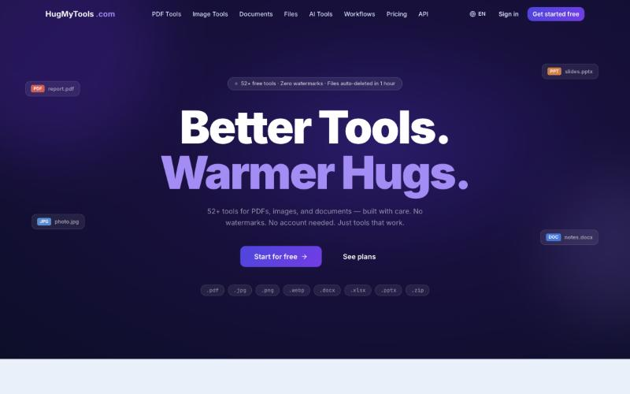
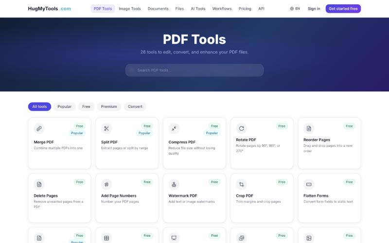
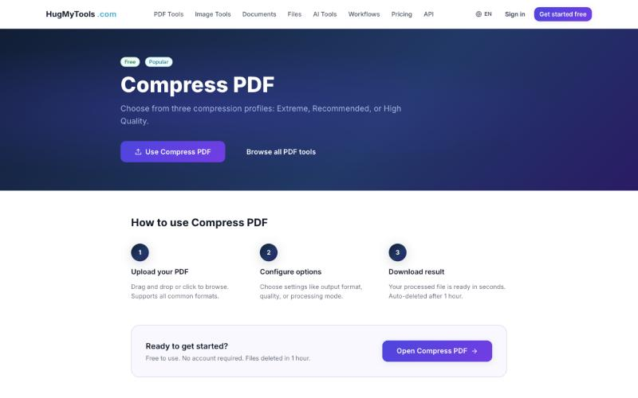

<!-- Header -->
<p align="center">
  
</p>

<p align="center">
  <a href="https://hugmytools.com">
    
  </a>
</p>

<p align="center">
  <a href="https://www.linkedin.com/in/rehan-ali-b80aab278/"></a>
  <a href="https://hugmytools.com"></a>
  <a href="mailto:rehanali.github@gmail.com"></a>
  
</p>

---

```bash
rehan@dev:~$ whoami
> Software Engineering student @ NIIT Lahore
> Full-stack web dev — Next.js · React · Python
> Currently: building & running HugMyTools in production
> Looking for: Software Engineering internship (Lahore · on-site / hybrid)

rehan@dev:~$ cat philosophy.txt
> Learn → Build → Deploy → Break → Understand → Rebuild
```

## 🚀 Featured — [HugMyTools](https://hugmytools.com)

> **52+ free online tools for PDFs, images, documents & AI.** No watermarks · no account · files auto-deleted after 1 hour.

<p align="center">
  <a href="https://hugmytools.com"></a>
</p>

<table>
  <tr>
    <td width="50%"><a href="https://hugmytools.com/pdf/"></a></td>
    <td width="50%"><a href="https://hugmytools.com/tool/compress-pdf/"></a></td>
  </tr>
  <tr>
    <td align="center"><sub>26 PDF tools: merge, split, compress, convert</sub></td>
    <td align="center"><sub>Per-tool pages with guided 3-step flow</sub></td>
  </tr>
</table>

**What I built & own end to end:**

- ⚡ **Next.js** front end (Turbopack): category hubs, 52+ tool pages, multi-language support
- 🔄 **Async processing queue** with real-time progress, so large files never hit browser timeouts
- 🤖 **AI tools**: summarise documents, remove backgrounds, upscale images
- 🔐 **Privacy by design**: files auto-deleted after 1 hour, optional accounts and cloud storage
- 🧩 Public **API docs**, workflows, pricing plans, deployment & infrastructure

<sub>🔒 Source is closed (it's a live product), but I'm happy to walk through the architecture in an interview.</sub>

## 🛠️ Tech stack

<p align="center">
  
  <br/>
  
</p>

## 📂 More projects

| Project | What it does | Stack |
|---|---|---|
| 📱 [**NetBridge-Android**](https://github.com/Dr-islo/NetBridge-Android) | Shares a phone's Wi-Fi with other devices over Wi-Fi Direct + a built-in HTTP/HTTPS proxy | Java · Android · CI |
| 🎓 [**LMS**](https://github.com/Dr-islo/LMS) | University learning management system with admin, instructor and student roles | PHP · MySQL |
| 🔐 [**IoT Network Log Analyzer**](https://github.com/Dr-islo/iot-network-log-analyzer) | Research: ML-based intrusion detection on IoT traffic (CICIDS2017/2018, NSL-KDD) | Python · ML |

## 🖥️ Homelab

<details>
<summary><b>I don't just write software. I run it.</b> (click to expand)</summary>

```text
┌─ rehan@homelab ─────────────────────────────────────────┐
│  $ neofetch                                             │
│  OS        Ubuntu / Linux                               │
│  Virtual   Proxmox · VMware                             │
│  Network   TCP/IP · DNS · DHCP · NAT · Firewalls        │
│  Remote    Tailscale                                    │
│  Servers   Nginx · Apache                               │
│                                                         │
│  $ systemctl status engineering                         │
│  ● active (running)                                     │
└─────────────────────────────────────────────────────────┘
```

Deploying and breaking my own services is how I learned what happens after `git push`.

</details>

## 📊 GitHub stats

<p align="center">
  
  
</p>

<p align="center">
  
</p>

---

<p align="center">
  
</p>

<p align="center">
  
</p>
